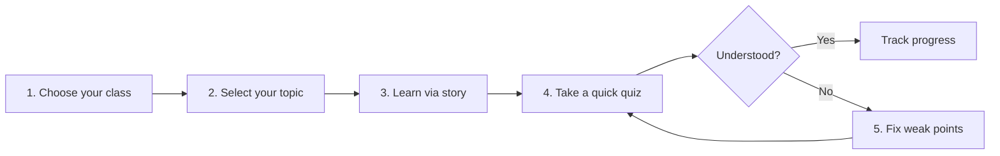

<div align="center">

# 📖 Story Teacher

### *Learn Anything. Remember Everything.*

**An AI-powered learning platform that turns school lessons into stories, then helps students practise, quiz, and re-learn what they missed.**

[](https://story-teacher-v9.vercel.app/)
[](https://story-teacher-v9.vercel.app/)
[](#-about-the-hackathon)
[](#)

[**🚀 Live Demo**](https://story-teacher-v9.vercel.app/) · [**✨ Features**](#-features) · [**🧭 How It Works**](#-how-it-works) · [**⚙️ Getting Started**](#️-getting-started) · [**🤝 Contributing**](#-contributing)

</div>

---

## 📌 Table of Contents

- [About the Project](#-about-the-project)
- [The Problem](#-the-problem)
- [Our Solution](#-our-solution)
- [Features](#-features)
- [How It Works](#-how-it-works)
- [Screenshots](#-screenshots)
- [Tech Stack](#️-tech-stack)
- [Getting Started](#️-getting-started)
- [Project Structure](#-project-structure)
- [Roadmap](#️-roadmap)
- [About the Hackathon](#-about-the-hackathon)
- [Contributing](#-contributing)
- [Author](#-author)
- [Acknowledgements](#-acknowledgements)

---

## 📖 About the Project

**Story Teacher** is an educational web platform for young learners, from **Play Group to Class 5**. It follows the **NEP 2020 pedagogical framework** and maps lessons to the school curriculum, then retells each concept as a short, engaging story. After the story, students take a quick quiz, and the platform re-teaches the parts they found hard in simpler words.

> Children remember stories far better than definitions. Story Teacher uses that to make early-years learning stick.

🔗 **Live application:** [story-teacher-v9.vercel.app](https://story-teacher-v9.vercel.app/)

---

## ❗ The Problem

- Young students often **memorise without understanding**, so concepts fade quickly.
- Textbook explanations are dense and **not engaging** for early learners.
- Most platforms test students but **don't re-teach** the exact gaps that caused a wrong answer.
- Parents and teachers have **no simple view** of where a child is struggling.

## 💡 Our Solution

Story Teacher closes the loop between *learning*, *testing*, and *re-learning*:

1. **Teach** each chapter as a short story told in scenes.
2. **Check** understanding with a quick quiz.
3. **Fix** weak points with a simpler re-explanation.
4. **Track** progress over time.

---

## ✨ Features

| | Feature | Description |
|---|---|---|
| 🎓 | **Curriculum-mapped content** | Lessons follow the school syllabus from Play Group to Class 5, with 100% curriculum mapping. |
| 📚 | **Learn via story** | Concepts are told as short, illustrated scenes instead of dry text. |
| 🧠 | **4 ways to learn** | Multiple learning modes so every child finds a style that works. |
| ✅ | **Quick quizzes** | Short quizzes right after each story to check what stuck. |
| 🔁 | **Fix weak points** | Wrong answers trigger a simpler re-teach that targets the gap. |
| 📈 | **My Progress** | A personal dashboard to follow learning over time. |
| 🗂️ | **Browse by class and subject** | Play Group, Nursery, LKG, UKG, and Classes 1 to 5, organised by subject. |
| 🔐 | **Easy sign-up** | One-click Google sign-in or email and password. |
| 🌙 | **Immersive, kid-friendly UI** | Bold visuals, colour-coded classes, and animated story scenes. |

---

## 🧭 How It Works



| Step | What happens |
|:---:|---|
| **1** | **Choose your class**, from Play Group to Class 5. |
| **2** | **Select your topic.** Every chapter follows your syllabus. |
| **3** | **Learn via story.** Concepts are told as short scenes. |
| **4** | **Take a quick quiz** to check what stuck. |
| **5** | **Fix weak points** with simpler re-teaching for the gaps. |

*Example: "The Seed That Slept", Class 1 · EVS · Plants.*

---

## 🖼️ Screenshots

> 📌 Add your screenshots to a `docs/screenshots/` folder and update the paths below.

| Home | Browse by Class | Sign Up |
|:---:|:---:|:---:|
|  |  |  |

---

## 🛠️ Tech Stack

> ✏️ **Edit this section to match your project.** Delete any rows that don't apply.

| Layer | Technology |
|---|---|
| **Frontend** | `<your framework, e.g. React / Next.js>` |
| **Styling** | `<e.g. Tailwind CSS / CSS Modules>` |
| **Backend / API** | `<e.g. Node.js / Express / serverless functions>` |
| **Database & Auth** | `<e.g. Supabase / Firebase>` · Google Sign-In |
| **AI / LLM** | `<e.g. Gemini API>` for story, quiz, and re-teach generation |
| **Deployment** | Vercel |

---

## ⚙️ Getting Started

### Prerequisites

- [Node.js](https://nodejs.org/) v18 or higher
- npm, yarn, or pnpm
- A Git client

### Installation

```bash
# 1. Clone the repository
git clone https://github.com/raunakdubey7891-del/story-teacher.git

# 2. Move into the project folder
cd story-teacher/story-teacher

# 3. Install dependencies
npm install
```

### Environment Variables

Create a `.env` file in the project root and add your keys:

```env
# Example, rename to match your project
GEMINI_API_KEY=your_api_key_here
DATABASE_URL=your_database_url_here
AUTH_GOOGLE_ID=your_google_client_id
AUTH_GOOGLE_SECRET=your_google_client_secret
```

> ⚠️ Never commit your `.env` file. Add it to `.gitignore`.

### Run Locally

```bash
npm run dev
```

Open [http://localhost:3000](http://localhost:3000) in your browser.

### Build for Production

```bash
npm run build
npm start
```

---

## 📁 Project Structure

> ✏️ Update this tree to reflect your real folders.

```
story-teacher/
└── story-teacher/
    ├── public/            # Static assets
    ├── src/
    │   ├── components/    # Reusable UI components
    │   ├── pages/         # Home, Learn, Subjects, My Progress, Auth
    │   ├── data/          # Curriculum, chapters, and stories
    │   └── lib/           # Helpers and API utilities
    ├── package.json
    └── README.md
```

---

## 🗺️ Roadmap

- [x] Class-wise browsing from Play Group to Class 5
- [x] Story-based lessons
- [x] Quick quizzes with re-teaching
- [x] Google and email authentication
- [x] Progress dashboard
- [ ] Voice narration for stories
- [ ] Regional language support
- [ ] Parent and teacher dashboard
- [ ] Offline mode for low-connectivity areas
- [ ] Higher classes (6 and above)

---

## 🏆 About the Hackathon

Story Teacher was built for **PromptWars x The Prompt Arena**, a build-and-pitch hackathon organised by **Pondicherry University** and the **Institution's Innovation Council (Ministry of Education initiative)**, in association with **Google for Developers** and **Hack2Skill**, held on **8 October 2026**.

---

## 🤝 Contributing

Contributions, issues, and feature requests are welcome!

1. Fork the project
2. Create your feature branch: `git checkout -b feature/amazing-feature`
3. Commit your changes: `git commit -m "Add amazing feature"`
4. Push to the branch: `git push origin feature/amazing-feature`
5. Open a Pull Request

---

## 👤 Author

**Raunak Dubey**
MCA, Pondicherry University

[](https://github.com/raunakdubey7891-del)
[](https://www.linkedin.com/)

---

## 🙏 Acknowledgements

- **Pondicherry University** and the **Institution's Innovation Council** for organising the event
- **Google for Developers** and **Hack2Skill** for the platform and opportunity
- **Dr. R. Sunitha** (Faculty Coordinator) and **Dr. K. Suresh Joseph** (Head of Department) for their guidance

---

<div align="center">

⭐ If you like this project, please consider giving it a star! ⭐

*Made with ❤️ for young learners.*

</div>
